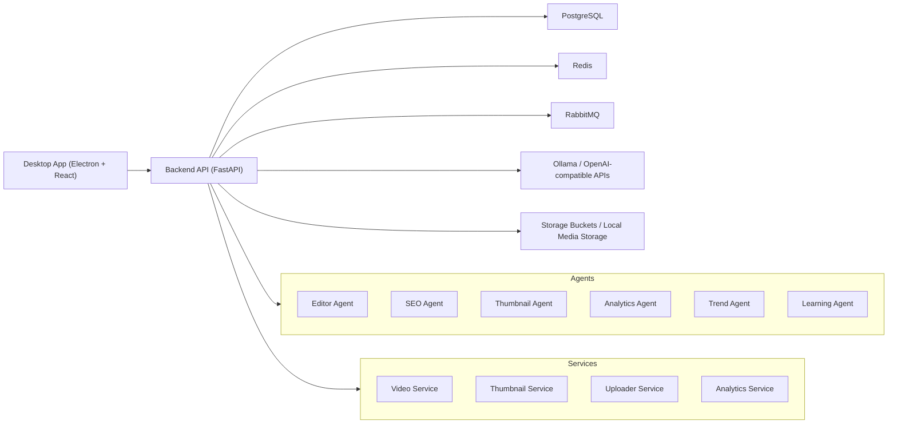

# Architecture

## Notes

- The current scaffold focuses on platform foundation, not business workflows.
- The backend owns orchestration, health, configuration, and shared integration boundaries.
- Services and agents are intentionally separated to preserve future deployment flexibility.
- Long-lived dependency clients are composed during application startup and reused across requests.
- The desktop shell consumes backend APIs through isolated client modules rather than direct feature-level fetch calls.
